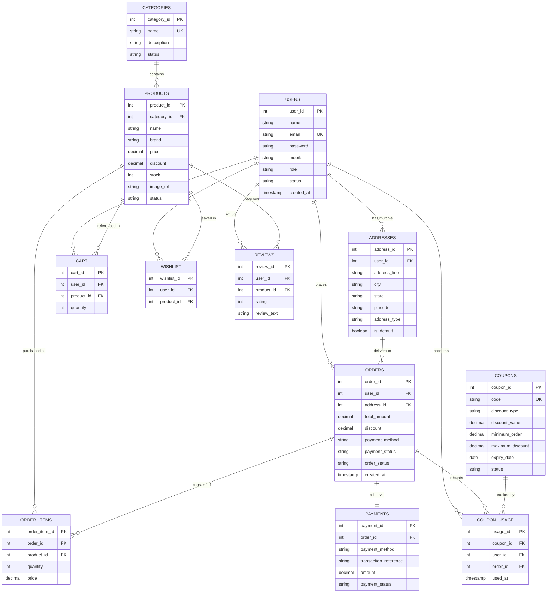
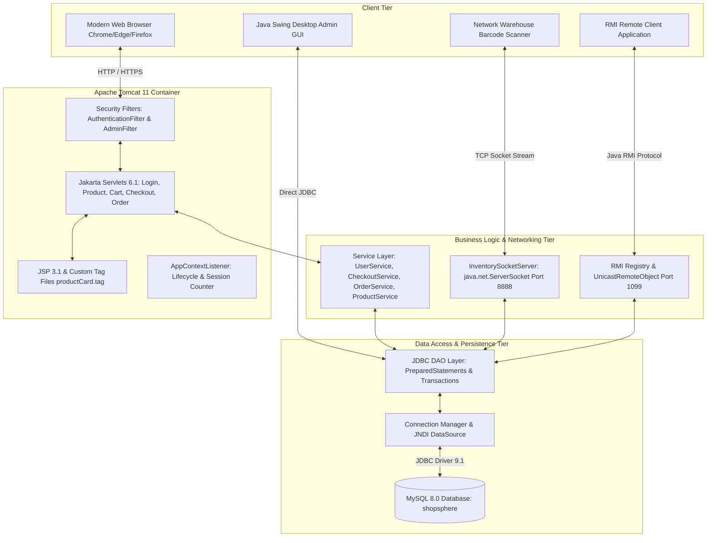
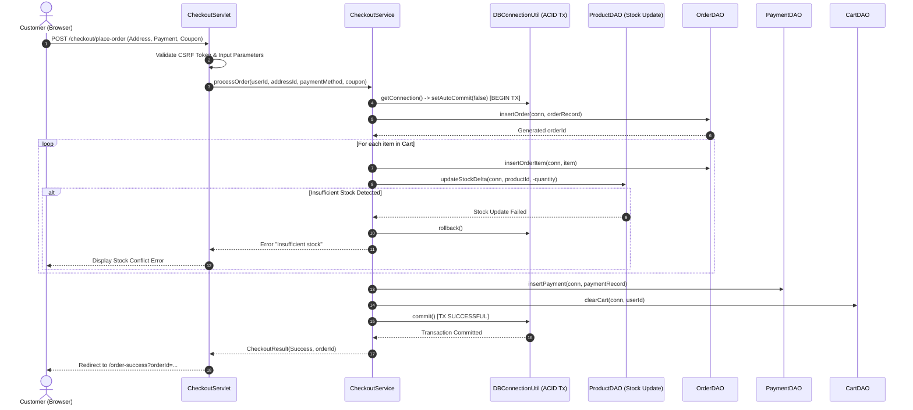
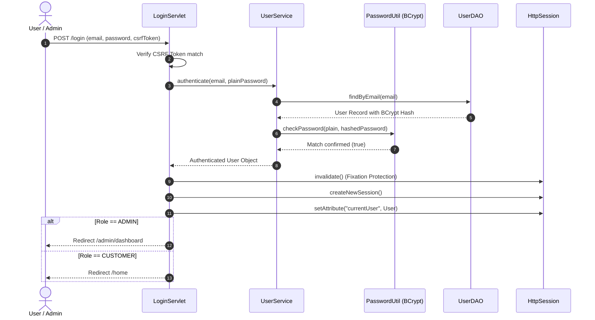

# ShopSphere Architecture & Design Diagrams

## 1. Relational Database Entity-Relationship (ER) Diagram

---

## 2. N-Tier System Architecture Diagram

---

## 3. Order Placement & ACID Transaction Sequence Diagram

---

## 4. User Authentication & Authorization Sequence Diagram

